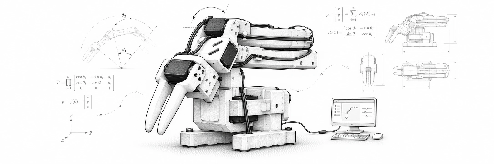

# SO-ARM Motion SDK

**Control SO-ARM101 from AI agents through a standard MCP interface with [Forge Puppeteer](https://github.com/AgenticForge-Labs/forge-puppeteer), or use this SDK directly to learn, teach, program, and automate the arm.**

Puppeteer offers MCP tool calls for supported native robot capabilities and shared behaviors, actions, and emotions across open-source robots. Inspired by [Reachy Mini](https://github.com/pollen-robotics/reachy_mini) and the [Reachy Mini Conversation App](https://github.com/pollen-robotics/reachy_mini_conversation_app), it generalizes conversational robot performance across devices. Tool availability depends on the selected server, configuration and operator grants; the SO-ARM101's physical controls remain subject to this SDK's own validation and authority.

SO-ARM Motion SDK is a Python-first toolkit for desktop robotics. Its current implemented and tested robot target is SO-ARM101. It brings together deterministic motion control, calibration, teaching and replay, a command-line interface, a PySide6 desktop GUI, local USB cameras, simulation, and constrained interfaces for higher-level applications.

**Connect → calibrate → move → teach → program → automate.**

## Supported hardware and future direction

- **SO-ARM101:** current supported hardware profile and validated software target, subject to the existing operator-led hardware qualification limits.
- **SO-ARM102:** a potential future hardware profile, **not implemented or validated**. Support must begin with a separate hardware/servo, calibration, kinematics, gripper, limits, workspace, STOP/HOLD and regression-test assessment before enabling physical operation.
- **SO-ARM100:** intentionally **not a compatibility target**. No SO-100 support is promised or required.

The project name is model-neutral, but its current Python distribution (`soarm101-motion-sdk`), import module (`soarm101_motion`), CLI (`soarm101`) and GitHub repository slug remain unchanged in this naming-only transition. Existing installs, references, SDK contracts and robot safety gates must continue to work. A future hardware-family refactor should use explicit model profiles rather than silently treating SO-102 as SO-101.


> **Hardware safety:** This is experimental software for an educational/hobby arm, not a safety-rated industrial controller. Never rely on software STOP/HOLD as an emergency stop. Keep a physical power cutoff within reach, start without a payload, and supervise initial motion. Read [Safety](docs/safety.md) and the [physical-run procedure](docs/physical-run.md) before moving hardware.

## Working with Forge Puppeteer

The SDK works independently through Python, the CLI, GUI, simulation and its trusted broker. [Forge Puppeteer](https://github.com/AgenticForge-Labs/forge-puppeteer) is an optional performance and MCP layer that can coordinate the arm with other robots. The SDK and its trusted broker retain control over calibration, physical motion, device limits, leases, STOP/HOLD and execution records. Connecting an agent or discovering a tool does not grant permission to move.

For implementation history and current qualification priorities, see [STATUS.md](STATUS.md) and [PLAN.md](PLAN.md).

## What you can do

- **Set up and calibrate the arm.** Discover serial devices, inspect motor status, confirm leader/follower assignment, and guide mechanical-stop calibration. Saved calibrations have identities used to guard motion replay.
- **Control joints and tool position.** Read measured joint state, use forward/inverse kinematics, plan joint-space and Cartesian movements, and operate the stock gripper through guarded SDK operations.
- **Teach and repeat tasks.** Save named positions, record and edit trajectories, and build deterministic programs with Move, gripper, and Wait steps. You do not need an AI agent to automate a repeatable task.
- **Use a desktop GUI.** Work with Setup, Manual control, Teleoperation, Teach/Record, recorded-motion editing, and Programs. A persistent follower sidebar displays measured state and STOP/HOLD controls.
- **Observe with USB cameras.** Configure named cameras such as `overhead` and `wrist`, preview them in the GUI, and capture still frames from the CLI and constrained agent interfaces.
- **Develop in Python or from the terminal.** The GUI, CLI, and Python SDK share motion, calibration, and saved-artifact foundations rather than implementing separate controllers.
- **Experiment with constrained agents.** An authenticated broker, bounded CLI, optional MCP adapter, and OpenShell sandbox integrations support agent workflows without granting unrestricted serial/motor access.

The project is intentionally lighter than a full ROS/MoveIt stack. It focuses on direct, understandable motion programming, calibration, teleoperation, repeatable bench workflows, and a deterministic safety boundary beneath higher-level reasoning.

## Quick start

### Requirements and installation

- Python **3.10 or newer**
- A compatible SO-ARM101 and Feetech servo interface for physical operation
- A supported computer with the relevant serial-device permissions
- No hardware required for GUI simulation or software-only tests

Clone and install the SDK with its GUI:

```bash
git clone https://github.com/AgenticForge-Labs/soarm101-motion-sdk.git
cd soarm101-motion-sdk
python3 -m venv .venv
source .venv/bin/activate
python -m pip install --upgrade pip
pip install -e ".[gui]"
```

Other installation options:

```bash
pip install -e .                    # SDK and CLI only
pip install -e ".[camera]"          # CLI camera capture
pip install -e ".[simulation]"      # optional PyBullet visualization
pip install -e ".[gui,simulation]"  # GUI and simulation
pip install -e ".[dev]"             # development/test dependencies
```

### Explore without hardware

```bash
soarm101-gui --simulation
soarm101 motion-envelope --json
soarm101 sdk-capabilities --json
```

To open the desktop app for real-hardware setup:

```bash
soarm101-gui
```

Use **Find Arms** to inspect detected devices before connecting. Discovery uses measured servo-bus voltage as a *hint*, not a definitive identification: a typical leader is around 5 V and follower around 12 V. Always confirm the physical ports and arm roles yourself.

### Set up a physical arm

Follow the [hardware setup guide](docs/hardware.md), [safety instructions](docs/safety.md), and [physical-run procedure](docs/physical-run.md). With the arm assembled and the correct port identified:

```bash
soarm101-setup --robot-id so101 --port /dev/ttyACM0
```

The setup utility checks the six-servo bus, applies supported motor configuration, and loads or guides calibration without enabling torque. Replace the port with your actual device (for example `COM7` on Windows).

For first powered movement, use the documented **attended, unloaded, single-joint smoke test** after confirming clearances and access to power:

```bash
soarm101 smoke-test --port /dev/ttyACM0 --robot-id so101 --joint shoulder_pan
```

**Do not operate the same serial port from the GUI and CLI simultaneously.** Calibration, pose libraries, and trajectories must match the active hardware calibration before physical replay.

## Everyday workflows

### Desktop GUI

Run `soarm101-gui` and use the tabs to progress from guided setup and manual joint/Cartesian motion to leader–follower teleoperation, taught poses, trajectories, and reusable programs.

The sidebar shows live follower joint/TCP estimates, gripper and torque state, and always-accessible hold/stop controls. Visual model geometry is an aid to interpretation, **not** proof of physical clearance or collision avoidance. See [Teleoperation](docs/teleoperation.md), [Programs](docs/programs.md), and [Kinematics](docs/kinematics.md).

### Command-line examples

Read-only inspection:

```bash
soarm101 discover
soarm101 workstation show --json
soarm101 diagnose --port /dev/ttyACM0 --robot-id so101
soarm101 read --port /dev/ttyACM0 --robot-id so101 --json
soarm101 motion-envelope --json
```

After calibration and a successful physical smoke test, a **human operator** can use guarded motion and taught positions:

```bash
soarm101 pose capture home --port /dev/ttyACM0 --robot-id so101
soarm101 pose go home --port /dev/ttyACM0 --robot-id so101
soarm101 sleep --port /dev/ttyACM0 --robot-id so101
soarm101 relax --port /dev/ttyACM0 --robot-id so101
```

Motion commands can enable torque or move the arm. `sleep` also closes the stock gripper by default; remove objects from its grasp and confirm the whole swept path is clear. Joint-space commands (`move-joints`, `jog-joint`, `pose go`, `sleep`, `sleep-up`, `sequence run`, `smoke-test`, and `agent` joint/pose/sleep commands) also accept `--profile-mode {minimum_jerk,cosine_cruise,scurve_paced,scurve_glide}` to compare the default quintic profile against half-cosine cruise timing side by side under identical safety guards (see `scripts/run_joint_profile_comparison.sh`). Use `soarm101 --help` and `soarm101 <command> --help` for syntax and options.

Two additional profiles, `scurve_paced` and `scurve_glide`, are experimental software prototypes for investigating slow motion and settling. They change servo pacing; `scurve_glide` also changes the joint-space path. They have not been physically qualified. Simulation does not model servo friction, internal firmware, or prove smoothness and clearance. The joint-profile comparison tools default to 24°/s and 75°/s²; pass explicit lower values when needed. See [TESTING.md](TESTING.md) before considering an operator-led trial.

Saved poses and programs remain independent of the selected joint profile. Recorded
motions retain their recorded trajectory; the selected joint profile can affect a
separate move to the recording's start. Switching profiles can change timing and
the path between poses, so existing calibration and workspace checks still apply.

### Python API

The Python SDK exposes the same calibrated motion foundation:

```python
from soarm101_motion import Pose, SOARM101

# Example for a supervised, calibrated physical arm.
with SOARM101(port="/dev/ttyACM0", robot_id="so101") as arm:
    arm.enable()
    arm.move_joints([0.0, -0.4, 0.7, 0.0, 0.2])
    current = arm.get_position()
    target = Pose(current.position + [0.01, 0.0, 0.0], current.rotation)
    arm.move_linear(target, orientation_mode="position_only", speed=0.01)
    arm.relax()
```

This is an API illustration, **not** a first-motion procedure or a guarantee of clearance for those coordinates. Follow the hardware guides and validate your own calibrated workspace before issuing a command.

### Cameras

The SDK maintains a shared workstation profile for named USB cameras:

```bash
soarm101 camera list --json
soarm101 camera capture --name overhead --json
soarm101 camera capture --all --json
```

Configure camera names/devices through the GUI or `soarm101 camera configure`. The SDK handles local camera capture; higher-level perception, camera-to-robot extrinsic calibration, and scene reasoning belong to applications above it. See [Camera](docs/camera.md).

## Agent integration

The integration rule is deliberately simple:

```text
Human / agent intent
        ↓
Constrained CLI, broker, or MCP capability
        ↓
Calibrated SO-ARM101 Motion SDK
        ↓
Servo hardware
```

A human must explicitly authorize bounded physical motion. The SDK and trusted host—not an LLM prompt—own calibration checks, limits, capability profiles, session authority, faults, and STOP/HOLD. An agent cannot obtain arbitrary motor access merely by discovering a tool.

Available interfaces include:

- The human/developer `soarm101` CLI and restricted `soarm101 agent ...` CLI.
- A broker with operator-pinned profiles, authentication, and audit events.
- An optional **[Forge Puppeteer](https://github.com/AgenticForge-Labs/forge-puppeteer)** stdio MCP interface that exposes reviewed broker capabilities without adding a second SDK MCP server.
- An OpenShell sandbox runner with Hermes, Codex, and operator-defined adapters.

**Important deployment distinction:** The standard physical agent broker remains CLI-backed. Native SDK simulation uses `--sdk-simulation`; the separate `--sdk-physical` option enables only experimental attended joint actions under the [restricted profile and watchdog contract](docs/agent-sandbox.md#attended-native-physical-joint-agents-experimental). General physical cutover still requires supervised in-motion STOP/watchdog qualification. Acknowledged software HOLD is not certified braking.

Example of **simulation-only** Codex/Puppeteer MCP operation (install `forge-puppeteer[mcp]` in the trusted host environment first):

```bash
soarm101 agent arm --simulation --minutes 10
soarm101 agent sandbox run --agent codex --auth installed \
  --interface mcp --sdk-simulation --task TASK.md \
  --output runs/codex-sdk-sim
```

This does not operate the physical arm. See [Agent CLI](docs/agent-arm101-cli.md), [Agent sandbox](docs/agent-sandbox.md), [Broker](docs/agent-broker.md), and [MCP](docs/agent-mcp.md) for current technical contracts and operator restrictions.

## Motion limits and safety

The configured absolute host motion envelope is **100°/s and 1000°/s²** for joints/tool rotation, and **100 mm/s and 1000 mm/s²** for TCP translation. These are *engineering ceilings*, **not normal defaults, safe recommendations, or proof of loaded-arm performance**. Actual requested motions can be slower and remain subject to calibration, joint/workspace limits, following-error, effort, fault, timing, STOP/HOLD, and settling checks. The default coarse modeled self-clearance is 20 mm; it is a heuristic, not a measurement or guarantee of physical clearance.

The stock arm has five pose joints plus a separate gripper. Its kinematic model estimates tool position from encoder readings; that estimate cannot replace measurements of actual workspace clearance. Motion recorded against one calibration is not silently replayable against a different calibration.

An earlier physical STOP experiment showed significant continued servo motion despite an acknowledged software response. Subsequent attended trials and additional settling checks do **not** turn the arm into a safety-rated device. Keep clear of moving links and use the physical cutoff when behavior is unexpected. Do not run physical motion tests unattended or from CI.

See [Safety](docs/safety.md), [Physical run](docs/physical-run.md), and [Validation](docs/validation.md).

## Architecture and scope

The SDK owns deterministic robot motion, basic USB camera sessions, hardware diagnostics, calibration and saved-motion provenance. It does not own ROS orchestration, perception/tracking, external stage-camera calibration, or autonomous task reasoning. LeRobot inspired portions of the hardware workflow but is optional and not imported at runtime; the SDK is independently implemented.

For design details, see [Architecture](docs/architecture.md), [Kinematics](docs/kinematics.md), and [Development plan](PLAN.md).

## Acknowledgments

Thanks to [The Robot Studio](https://github.com/TheRobotStudio/SO-ARM100) and [Hugging Face LeRobot](https://github.com/huggingface/lerobot) for the open SO-101 arm and robotics ecosystem. This SDK is independently implemented; LeRobot is optional. [Forge Puppeteer](https://github.com/AgenticForge-Labs/forge-puppeteer) provides the shared agent-facing MCP layer, inspired by [Reachy Mini](https://github.com/pollen-robotics/reachy_mini) and its [Conversation App](https://github.com/pollen-robotics/reachy_mini_conversation_app).

## Development and contributions

Contributions to setup, documentation, kinematics, motion planning, teaching/programming tools, tests, and usability are welcome. For a problem report, include the operating system, arm configuration, relevant calibration details, and sanitized logs; never publish tokens or sensitive paths.

For software-only validation, install the development extras and run:

```bash
ruff check .
python -m pytest --no-cov -q
```

The test suite has hardware-free simulation and fake-transport coverage. Passing those tests does **not** establish physical safety or authorize unattended robot motion. Hardware testing follows separate operator-controlled procedures in [TESTING.md](TESTING.md).

Open an [issue](https://github.com/AgenticForge-Labs/soarm101-motion-sdk/issues) or [pull request](https://github.com/AgenticForge-Labs/soarm101-motion-sdk/pulls), or contact [AgenticForge Labs](mailto:info@agenticforgelabs.com).

## Documentation

| Topic | Guide |
| --- | --- |
| Getting started with physical hardware | [Hardware setup](docs/hardware.md) · [Physical run](docs/physical-run.md) |
| Safety and testing | [Safety](docs/safety.md) · [TESTING.md](TESTING.md) |
| Teaching and motion | [Programs](docs/programs.md) · [Teleoperation](docs/teleoperation.md) · [Kinematics](docs/kinematics.md) |
| Camera and simulation | [Camera](docs/camera.md) · [Simulation](docs/simulation.md) |
| Agent operation | [Agent CLI](docs/agent-arm101-cli.md) · [Sandbox](docs/agent-sandbox.md) · [Broker](docs/agent-broker.md) · [MCP](docs/agent-mcp.md) |
| Project structure and plans | [Architecture](docs/architecture.md) · [PLAN.md](PLAN.md) |

**License:** Apache 2.0. Maintained by AgenticForge Labs.

### Offline asset catalog

`soarm101_motion.asset_catalog.discover_assets` enumerates explicitly selected
pose, trajectory, and sequence libraries without connecting to a robot. See
`examples/asset_catalog.py`. Descriptors contain content revisions and calibration
provenance. A calibration match only compares the supplied identity; sequence
compatibility remains unchecked because referenced steps must also be validated.
Discovery does not grant replay, check live authority, or certify physical safety.


Explicitly granted recording and ordered sequence replay are available only in
supervised native SDK simulation, using operator-pinned hashes, calibration,
start tolerances, broker profile grants, watchdog and STOP fencing. Simulation
replay remains unarmed and does not create or require physical authority. Replay
reuses the broker's existing SDK session and retains request identities for
response reconciliation. Sequence steps include saved poses, recordings, gripper
targets and waits. See
[broker replay](docs/agent-broker.md#supervised-recording-replay-simulation-only).
Automatic entry motion and physical replay remain unavailable.
